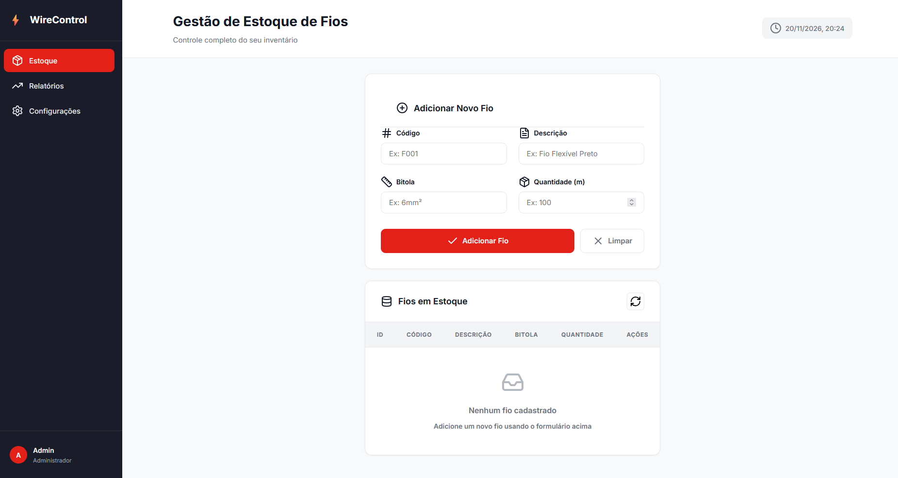

# WireControl

Sistema web de controle de estoque de fios elétricos: cadastrar, consultar, editar, excluir e ajustar a quantidade de fios por código, descrição e bitola.

🔗 **Acesse:** https://wirecontrol.onrender.com

> ⏳ O servidor é gratuito e dorme depois de 15 minutos sem uso. O primeiro acesso pode levar até 2 minutos. Depois disso, fica rápido.



## Funcionalidades
- Cadastro de fios com código único, descrição, bitola e quantidade
- Listagem e busca por ID ou código
- Edição e exclusão de registros
- Ajuste rápido de quantidade (entrada/saída de estoque), sem deixar ficar negativa
- API REST consumida por um frontend em HTML, CSS e JavaScript puro

## Tecnologias
| Camada    | Stack |
|-----------|-------|
| Backend   | Java 17, Spring Boot 3.5, Spring Web, Spring Data JPA |
| Banco     | PostgreSQL 17 |
| Frontend  | HTML, CSS, JavaScript (Fetch API), servido pelo próprio Spring |
| Contêineres | Docker (Dockerfile multi-stage) e Docker Compose |
| Hospedagem | Render (aplicação) e Neon (banco) |

## Como rodar no seu PC
**Pré-requisitos:** [Git](https://git-scm.com) e [Docker](https://www.docker.com/products/docker-desktop/). Não precisa de Java nem de PostgreSQL instalados.

1. Baixe o projeto:
   ```bash
   git clone https://github.com/NahanM/WireControl.git
   cd WireControl
   ```
2. Crie o arquivo `.env` a partir do modelo e coloque uma senha no lugar de `troque-esta-senha`:
   ```bash
   cp .env.example .env        # Linux/macOS
   copy .env.example .env      # Windows
   ```
3. Suba tudo:
   ```bash
   docker compose up --build
   ```
4. Abra http://localhost:8080

Para parar: `Ctrl+C`. Para apagar os contêineres e manter os dados: `docker compose down`.

## Endpoints da API
Base: `/api/fios`

| Método | Rota                        | Descrição            |
|--------|-----------------------------|----------------------|
| GET    | `/api/fios`                 | Lista todos os fios  |
| GET    | `/api/fios/{id}`            | Busca por ID         |
| GET    | `/api/fios/codigo/{codigo}` | Busca por código     |
| POST   | `/api/fios`                 | Cadastra um novo fio |
| PUT    | `/api/fios/{id}`            | Atualiza um fio      |
| DELETE | `/api/fios/{id}`            | Remove um fio        |
| PATCH  | `/api/fios/{id}/quantidade?quantidade=10` | Soma (ou subtrai, com valor negativo) à quantidade |

Exemplo de corpo (POST/PUT):
```json
{
  "codigo": "F-2.5-AZ",
  "descricao": "Cabo flexível azul",
  "bitola": "2,5 mm²",
  "quantidade": 100
}
```

## Arquitetura
Como as peças se conectam e o que cada pasta faz: [docs/arquitetura.md](docs/arquitetura.md).

## Limitações conhecidas
- **Sem login:** o usuário "Admin" no canto da tela é só visual. Qualquer pessoa com o link pode cadastrar, editar e excluir.
- **Menus Relatórios e Configurações:** aparecem na tela, mas não foram implementados.
- **Servidor gratuito:** dorme depois de 15 minutos sem uso, e o primeiro acesso demora.
- **Sem busca por descrição:** só por ID e por código.
- **Sem testes automatizados.**

## Autor
Feito por **Nahan Miguel Barbosa** · [GitHub](https://github.com/NahanM)